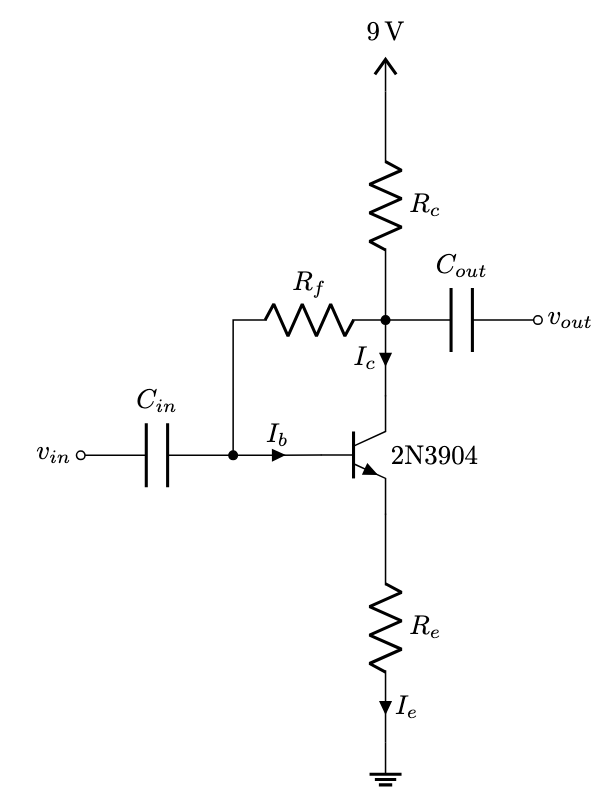
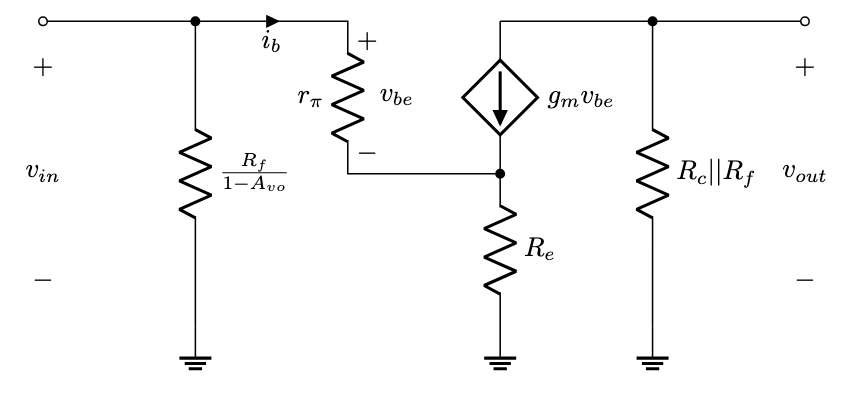
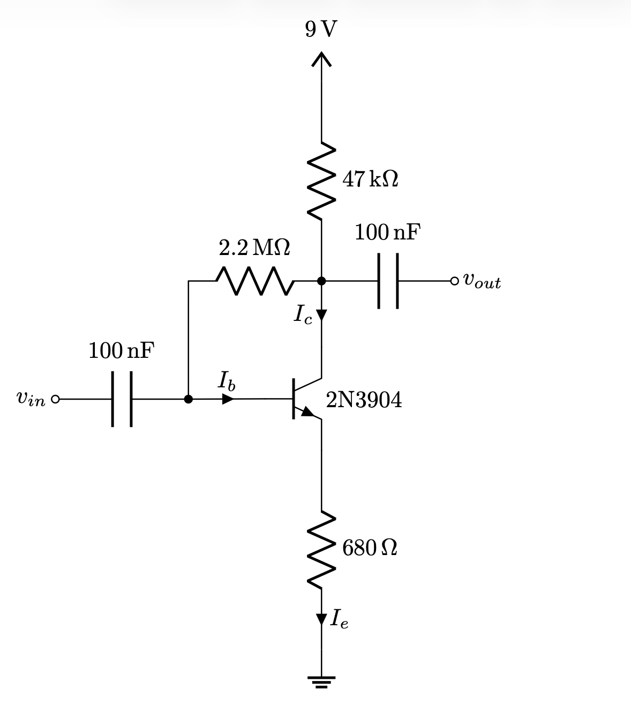
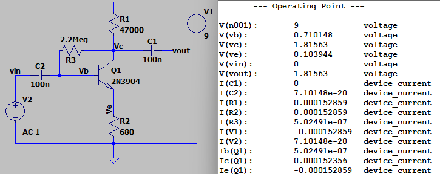
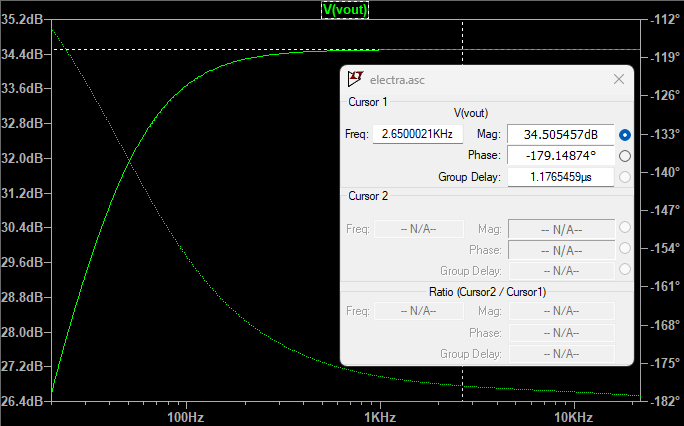
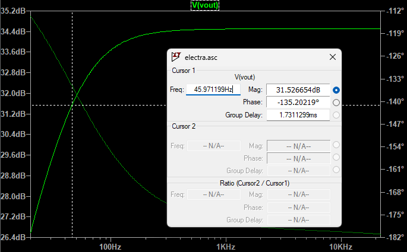
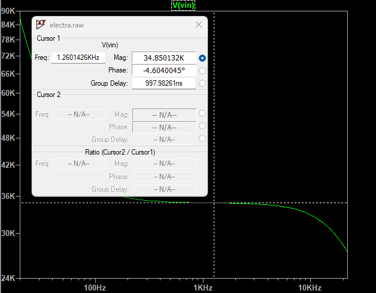
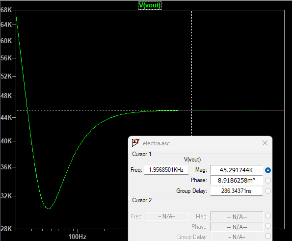
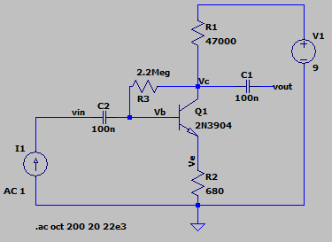
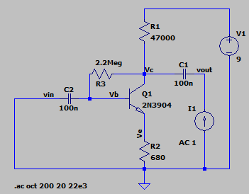

I was recently watching some episodes of the [Short Circuit](https://youtube.com/playlist?list=PL_cgYn-EP29auNC4wm9fkpeqbSylf3qQV&si=msqbnsRuPn906S87) series by JHS Pedals. The series starts by looking at an LPB1 boost pedal, which is a common emitter (CE) amplifier with emitter degeneration with the BJT biased via a voltage divider. The series continues by looking at the Electra Distortion circuit, which has a very similar circuit topology, except that the biasing is accomplished instead via a shunt feedback resistor between the base and collector of the transistor. Today, I discovered that the Big Muff Pi pedal uses multiple of these shunt feedback common emitter stages in series, as does another fuzz pedal that I like a lot - the Way Huge Swollen Pickle (yes, it's really called that). Josh mentions it is used in a ton of different pedals, so this is probably not even scratching the surface. As someone interested in designing my own pedals, it feels useful to analyze the circuit to build an intuition for what each component does. This post will look at the basic circuit, a CE amplifier biased by a feedback resistor \\(R_f\\), as it appears in the Electra Distortion circuit. 

# DC Analysis

Like any BJT amplifier, the first step is to determine the DC operating point, i.e. the quiescent point of the circuit. To do this, all capacitors in the circuit are viewed as open circuits, and then the circuit is analyzed to determine the operating point.

Performing KVL from \\(V_{CC}\\) down to ground, across \\(R_F\\) and the base to emitter junction,

\[V_{cc} - (I_b + I_c)R_c - I_bR_f - V_{be} - (I_b+I_c)R_e = 0\]

Since \\(I_c = \beta I_b\\) by the Ebers-Moll model,

\[V_{cc} - (\beta+1)I_bR_c - I_bR_f - V_{be} - (\beta+1)I_bR_e = 0\]

\[I_b = \frac{V_{cc} - V_{be}}{R_f + (\beta+1)(R_c+R_e)}
\]

and

\[I_c = \frac{\beta (V_{cc} - V_{be})}{R_f + (\beta+1)(R_c+R_e)}
\]

# AC Analysis
For AC analysis, the capacitors in the circuit are viewed as short ciruits and the BJT is replaced by the [hybrid-pi model](https://en.wikipedia.org/wiki/Hybrid-pi_model). The DC voltages sources are also treated as ground.

## Miller's Theorem
Part of why I wanted to analyze this circuit is that I don't have much experience with feedback networks outside of op amp circuits. I learned that [Miller's Theorem](https://en.wikipedia.org/wiki/Miller_theorem) can be used for this. The theorem says that a branch with an impedance \\(Z\\), connecting two nodes with voltages \\(V_1\\) and \\(V_2\\), can be replaced by two branches connecting those nodes to ground with "Miller impedances" equal to \\(\frac{Z}{1-K}\\) (from \\(V_1\\) to ground) and \\(\frac{KZ}{K-1}\\) (from \\(V_2\\) to ground), where \\(K=\frac{V_2}{V_1}\\). In this case, \\(V_2\\) is the collector voltage, and \\(V_1\\) is the base voltage, so \\(K\\) is equal to the gain of the amplifier stage, \\(A_{v}\\). When \\(A_{v} \gg 1\\), the Miller impedance from \\(V_2\\) to ground becomes approximately \\(Z\\), the original impedance. 

In this circuit, that looks like removing \\(R_f\\), and adding it back to the circuit connected between the collector to ground, and then adding a new resistor connected from the base to ground with value \\(\frac{R_f}{1-A_{v}}\\).

## Gain (\\(A_v\\))

With the equations \\(v_{be} = i_b r_{\pi} \\), \\(\beta = g_m r_{\pi}\\), and \\(g_m=\frac{I_c}{V_T}\\),

$$v_{out} = -g_m(i_b r_{\pi})(R_c||R_f)$$
$$v_{in} = i_b[(\beta+1)R_e+r_{\pi}] \approx i_b(g_mr_{\pi}R_e+r_{\pi})$$
$$A_{v} = \frac{v_{out}}{v_{in}} = \frac{-g_m(i_b r_{\pi})(R_c||R_f)}{i_b(g_mr_{\pi}R_e+r_{\pi})}=\frac{-g_m(R_c||R_f)}{g_mR_e+1}$$

## Input Resistance (\\(R_{in}\\))

The input resistance \\(R_{in}\\) is defined as

$$R_{in} = \frac{v_{in}}{i_{in}}$$

From the gain calculation,
$$v_{in} = i_b[(\beta+1)R_e+r_{\pi}]$$
Since \\(i_b\\) is the current flowing into the base, the resistance looking into the base is 
$$\frac{v_{in}}{i_b} = (\beta+1)R_e+r_{\pi}$$

This resistance is in parallel with the Miller resistance \\(\frac{R_f}{1-A_{v}}\\), so the total input resistance of this amplifier stage is
$$R_{in}=\big((\beta+1)R_e+r_{\pi}\big)||\big(\frac{R_f}{1-A_{v}}\big)$$

With this configuration, it is interesting that \\(R_{in}\\) is now a function of \\(A_v\\), which is a function of the impedance of the load that is connected to \\(v_{out}\\), e.g. a resistor or the input resistance of a subsequent amplifier stage. When the load impedance is an open circuit, \\(A_v\\) is at its largest, and \\(R_{in}\\) at its smallest. As the load impedance decreases, \\(A_v\\) drops and the input resistance increases. This is due to the Miller resistance from the base to ground being inversely proportional to the voltage gain.

## Output Resistance (\\(R_{out}\\))

The output resistance \\(R_{out}\\) is simply

$$R_{out} = R_c||R_f$$

# The Electra Distortion
The Electra Distortion circuit, as described in the [JHS Pedals video](https://www.youtube.com/watch?v=BCF1hGa7JTw), looks like this without the clipping diodes and volume potentiometer:

I didn't include the clipping diodes in the circuit diagram because they can't be analyzed using linear AC analysis techniques. I left the volume potentiometer out as well.

## DC Analysis
First, calculating the DC operating point assuming \\(V_{be}\\) is 0.7 Volts and \\(\beta = 300\\) for the 2N3904,
\[I_b = \frac{V_{cc} - V_{be}}{R_f + (\beta+1)(R_c+R_e)} = \frac{9\text{ V} - 0.7\text{ V}}{2200000 + (300+1)(47000+680)} = 0.5015\text{ uA}
\]
\[I_c = \beta I_b = 300 (0.5015\text{ uA}) = 150.438\text{ uA}
\]

Quickly looking at \\(V_{ce}\\) to get an idea of how the BJT will clip the signal,
\[
    V_{ce} = 9 - (301)(0.5015\text{ uA})(47000 + 680) = 1.803\text{ V}
\]
With \\(V_{ce} = V_{cc}/2 = 4.5\text{ V}\\) being half way between saturation and cut-off, the BJT in this circuit is biased closer to saturation, meaning that the output signal will be asymmetrically clipped if \\(V_{ce}\\) swings 1.6 V or so (when \\(V_{ce}\\) reaches about 0.2 V).

## AC Analysis
\[g_m=\frac{I_c}{V_T} = \frac{150.438 \text{ uA}}{26\text{ mV}} = 0.005863 \text{ A/V}\]
\[
    A_v=\frac{-g_m(R_c||R_f)}{g_mR_e+1}=\frac{-0.005863(46017)}{0.005863(680)+1}=-54.1\text{ V/V}
\]
\[
    A_{v,\text{dB}}=20\text{log}_{10}(54.1) = 34.66\text{ dB}
\]

\[
    r_{\pi}=\frac{\beta}{g_m} = \frac{300}{0.005863} = 51168 \text{ Ω}
\]

\[
    R_{in}=\big((\beta+1)R_e+r_{\pi}\big)||\big(\frac{R_f}{1-A_{v}}\big)=\big(301*680+51168\big)||\big(\frac{2200000}{1+54.1}\big)=34.5\text{ kΩ}
\]

\[
    R_{out}=R_c||R_f=47000||2200000=46\text{ kΩ}
\]

Looking into the amplifier stage, \\(R_{in}\\) appears as a shunt resistance to ground. This interacts with the series 100 nF capacitor at the base to form an RC high pass filter. The 3 dB point is
\[
f_{3\text{dB}} = \frac{1}{2\pi RC} = \frac{1}{2\pi(34.5 \text{ kΩ})(100\text{ nF})} = 46.1\text{ Hz}
\]

The output resistance appears as a series resistance which when combined with any shunt capacitance connected from the collector to ground, would form an RC low pass filter. There is currently no such capacitance, so there is no low pass effect (aside from the inherent capacitance of the BJT that puts a lowpass pole somewhere well out of the audio band).

## Simulations
Building the circuit in LTspice and running a DC simulation, it shows very close to what I calculated.

|  Parameter     | Calculated | Simulated |
| ---------- | ---------- | ---------- | 
| Base current, \\(I_b\\)  | 0.502 uA | 0.502 uA | 
| Collector current, \\(I_c\\)  | 150.4 uA | 152.3 uA | 
| Collector-to-emitter voltage, \\(V_{ce}\\) | 1.8 V | 1.71 V | 

Running an AC simulation from 20 Hz to 22 kHz, the results are also very close to the calculations.

|  Parameter      | Calculated | Simulated |
| --------------- | ---------- | ---------- | 
| Gain, \\(A_v\\) | 34.66 dB | 34.5 dB | 
| Highpass cutoff, \\(f_{3\text{dB}}\\) | 46.1 Hz | 45.97 Hz | 
| Input resistance, \\(R_{in}\\) | 34.5 kΩ| 34.85 kΩ|
| Output resistance, \\(R_{out}\\) | 46 kΩ| 45.29 kΩ| 

The circuit setup to simulate input impedance was this:

And the circuit setup to simulate output impedance was this:

# Insights
Going through the analysis allowed me to see what each component does in the circuit in a mathematical way. Notes on each component:

- The BJT: Higher \\(\beta\\) transistors result in higher \\(I_c\\), biasing more toward saturation since with higher collector current there is a larger voltage drop across \\(R_c\\). Gain is not as affected as it otherwise would be due to emitter resistor \\(R_e\\) and feedback resistor \\(R_f\\).
- \\(R_f\\): Biases the BJT and creates negative feedback that helps stabilize the DC operating point. Higher values result in lower \\(I_b\\) and \\(I_c\\) which biases the BJT more toward cutoff. Higher values of \\(R_f\\) also increases input resistance since the Miller resistance at the base is directly proportional to its value. Reduces gain by being in parallel with \\(R_c\\) from an AC perspective.
- \\(R_c\\): Primary resistor that sets the AC voltage gain \\(A_v\\). Higher values result in more gain, and consequencently results lower input resistance since \\(R_{in}\\) is inversely proportional to gain with this feedback configuration. Larger \\(R_c\\) also biases the BJT more toward saturation for the same reason that a larger \\(I_c\\) does (larger voltage drop across \\(R_c\\)). 
- \\(R_e\\): Higher values provides more stability against differences in \\(\beta\\) and temperature, but decreases gain.
- \\(C_{in}\\): DC blocking capacitor. Forms an RC high pass filter with the input resistance of the amplifier stage. Higher values result in a lower cutoff frequency, allowing more bass frequencies into the circuit.
- \\(C_{out}\\): DC blocking capacitor. Forms an RC high pass filter with the input resistance of the following stage. Higher values result in a lower cutoff frequency, allowing more bass frequencies into the circuit.

In the end, what matters is what sounds good, so analytically choosing component values is probably not how I would want to build a pedal exclusively. Knowing the analysis behind it and what other pedals that use this topology use for component values, might help in intuiting how to achieve a certain sound. 

In the next post in this series I intend to look at other modifications and additions to this circuit that I see in other pedals, including those found in the Big Muff Pi and Way Huge Swollen Pickle.

> All circuit diagrams in this post were drawn with [CircuiTikz](https://www.overleaf.com/learn/latex/CircuiTikz_package), and all simulations were done with [LTspice](https://www.analog.com/en/resources/design-tools-and-calculators/ltspice-simulator.html).